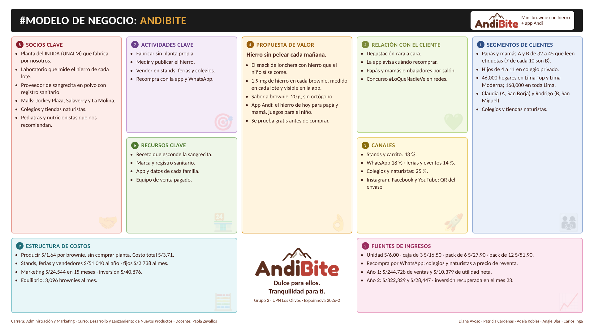

# AndiBite · Informe del proyecto · Model Business Canvas · Expoinnova 2026-2
Responsable: Grupo 2 (Diana Ayoso, Patricia Cárdenas, Adela Robles, Angie Blas y Carlos Inga) · UPN Los Olivos · Administración y Marketing · Curso Desarrollo y Lanzamiento de Nuevos Productos · Docente Paola Zevallos

## AndiBite en una página

**Qué es.** AndiBite es un mini brownie de 20 gramos para la lonchera, con sangrecita de res liofilizada escondida en la receta. Cada unidad aporta 1.9 mg de hierro hemo, el de origen animal, que el cuerpo absorbe mejor, y se mide en laboratorio en cada lote. Sabe a brownie, no lleva octógonos y viene en tres sabores: Chispa, Andi y Lúcu. Con cada envase viene un código QR que abre la app **Andi**, donde papá y mamá ven «el hierro de hoy» de su hijo, arman la lonchera de la semana, reciben el aviso de recompra y vuelven a pedir por WhatsApp en un clic; el niño, por su lado, juega con Andi, una llamita exploradora.

**El problema que resolvemos.** En el Perú, uno de cada seis niños de 5 a 11 años tiene anemia (INS-CENAN, 2025). Los papás y las mamás de Lima lo saben y lo intentan: esconden el hígado, disfrazan la sangrecita, inventan un cuento. Y casi siempre gana el niño: la lonchera vuelve llena y el jarabe sabe a metal. En 25 entrevistas a profundidad escuchamos la misma escena una y otra vez. Darle hierro a un niño es una pelea de todas las mañanas.

**Nuestra respuesta.** No inventamos otro alimento sano: inventamos un brownie que el niño vuelve a pedir, con el hierro escondido adentro, y una app que convierte esa lonchera en un dato que papá y mamá pueden ver. Ocho mamás probaron el prototipo y ninguna notó la sangrecita. Nuestra propuesta en una frase: **hierro sin pelear cada mañana**. Nuestro slogan: «Dulce para ellos. Tranquilidad para ti.»

**Para quién.** Padres y madres de 32 a 45 años de los niveles socioeconómicos A y B, con hijos de 4 a 11 años en colegio privado, que leen etiquetas e invierten en salud. Empezamos por Lima Top y Lima Moderna, donde hay 46,000 hogares con ese perfil, y el mercado al que apuntamos son los 168,000 hogares A/B de toda Lima.

**Por qué es un negocio digital.** El envase es la puerta de entrada a la app: el QR desbloquea el plan de loncheras con inteligencia artificial, la recompra se cierra por WhatsApp y la comunicación va en video por Instagram, Facebook y YouTube. La venta empieza en la calle, en el stand donde el niño prueba, y continúa en el celular.

**Video de presentación (YouTube):** {{VIDEO_URL}}

**Las cifras del plan (año 1, 2027).**

| Indicador | Valor |
|---|---|
| Brownies vendidos | 52,331 |
| Ventas con IGV | S/244,728 |
| Resultado operativo | S/13,423 (6.5 % de las ventas) |
| Utilidad neta | S/10,379 |
| Inversión inicial | S/40,876 (socios S/25,000 y préstamo S/16,000) |
| Recuperación de la inversión | Mes 23 (noviembre de 2028) |
| Año 2 (2028) | S/322,329 de ventas y S/28,447 de utilidad neta |

## El modelo de negocio en un vistazo

En las páginas siguientes explicamos, uno por uno, los nueve bloques del Canvas.

## 1. Segmento del cliente

AndiBite vende directamente a las familias (B2C). Un segundo frente, más pequeño, es la venta a colegios privados y tiendas naturistas (B2B), que juntos representan la cuarta parte del volumen y sirven para estar donde el niño y sus padres ya están.

**Quiénes son.** Padres y madres de 32 a 45 años, de los niveles socioeconómicos A y B, con hijos de 4 a 11 años en colegio privado. Son personas conscientes y planificadas: leen etiquetas, preguntan al pediatra, invierten en educación y salud y compran en Wong, Flora & Fauna, Plaza Vea, por aplicativo y por WhatsApp. Dos datos del mercado describen su comportamiento: el 83 % cambia su compra por los octógonos (Ipsos, 2025) y el 42 % desconfía de lo envasado (Kantar, 2025). Lo que piden es sencillo de decir y difícil de cumplir: algo que el niño sí coma, que lleve hierro de verdad y que entre en la lonchera sin pelea.

**Cómo elegimos este segmento.** La primera investigación, con diez entrevistas y un focus group en Lima Norte (NSE C y B), nos enseñó dos cosas. La sangrecita se acepta cuando va escondida en algo dulce, y sin la prueba del niño no hay compra. Pero el precio no alcanzaba: esas familias pagaban de S/3 a S/5 por porción y el costo del producto no lo permitía. Movimos el foco a los hogares A y B, donde el precio del pack de 6 (S/26.90 a S/27.90) se valida con una encuesta a 30 padres y madres. Como siete de cada diez hogares A/B de Lima son B (APEIM, 2025), el esfuerzo comercial es parejo para los dos niveles y la pauta se reparte por mitades entre Lima Top y Lima Moderna.

**Dos buyer persona guían las decisiones.**

| | Claudia Mendoza (segmento A) | Rodrigo Salazar (segmento B) |
|---|---|---|
| Quién es | 38 años, abogada, San Borja; dos hijos de 7 y 4 | 40 años, jefe de logística, San Miguel; dos hijos de 9 y 6 |
| Ingreso del hogar | S/13,500 al mes | S/8,500 al mes |
| Dónde compra | Wong, Flora & Fauna, Instagram | Plaza Vea, aplicativos, WhatsApp |
| Qué busca | Saber qué come su hijo; pregunta al pediatra | Una mañana menos de pelea; mira el precio por brownie |
| Su frase | «Todo lo que le hace bien, mi hijo lo escupe.» | «No me vendas salud, véndeme una mañana menos.» |
| Pagaría por el pack de 6 | S/24 a S/30 | S/18 a S/24 |

**Tamaño del segmento y cuán fácil es llegar.** El núcleo son 46,000 hogares A/B con niños de 4 a 11 años en Lima Top (Miraflores, San Isidro, San Borja, Surco y La Molina) y Lima Moderna (Jesús María, Lince, Pueblo Libre, Magdalena y San Miguel), que gastan unos S/17.3 millones al año en snacks de lonchera. El mercado al que apuntamos son los 168,000 hogares A/B de toda Lima (S/62.8 millones) y el mercado total llega a 932,000 hogares (S/130.9 millones). Las ventas del primer año equivalen al 1.4 % del núcleo: una meta exigente, pero alcanzable. Llegar a estas familias es relativamente fácil porque se concentran en pocos lugares: los centros comerciales donde pasan el fin de semana (Jockey Plaza, Real Plaza Salaverry), los colegios privados de sus hijos y las redes sociales donde ya buscan consejos de alimentación.

## 2. Relación de clientes

La relación con el cliente es personal en el momento decisivo, la prueba, y automatizada después, en la app y en WhatsApp. La tabla sigue a la familia desde que nos conoce hasta que vuelve a comprar.

| Etapa | Qué queremos lograr | Qué hacemos |
|---|---|---|
| Consideración | Que papá y mamá se reconozcan en el problema | Campaña «Lo que nadie ve» en video (Instagram, Facebook y YouTube); concurso #LoQueNadieVe, en el que cada papá o mamá cuenta su truco para que su hijo coma lo sano; embajadores en los salones |
| Evaluación | Que el niño pruebe y pida más | Degustación gratis en el stand a cambio de contar el truco; el niño prueba, papá y mamá ven la reacción; cartel con el hierro medido del lote y el registro sanitario |
| Compra | Que la primera compra sea fácil y sin riesgo | Packs de 6 y 12 para la semana; pago en el stand; pedido por WhatsApp con entrega agrupada dos días por semana o recojo en el stand |
| Lealtad | Que la familia vuelva sin que tengamos que buscarla | La app muestra «el hierro de hoy», avisa cuando el pack se acaba y permite recomprar en un clic; semáforo semanal de hierro; recordatorio del control de hemoglobina; juegos para el niño |

**Cómo llegan y por qué vuelven.** Las familias nuevas llegan por dos vías de bajo costo: la degustación (cada feria y evento deja contactos de WhatsApp) y los papás y mamás embajadores, con un fondo de incentivos de S/200 al mes, que traen unas 20 familias nuevas cada mes; el premio es siempre para el adulto, nunca para el niño. La recompra se mide con una cifra: el 35 % de lo que se vende en físico vuelve a comprarse por WhatsApp. El concurso #LoQueNadieVe (del 1 de noviembre al 20 de diciembre de 2026) es por votos, no por sorteo, y su objetivo es llegar al lanzamiento con 100 familias en WhatsApp y 500 seguidores. Para el cierre del año 1 la meta es una comunidad de 2,300 familias.

## 3. Canales de distribución

El canal principal es la venta física y directa: el niño prueba en el stand y el papá o la mamá compra ahí mismo. Los canales digitales cumplen otra función: dar a conocer la marca, llevar a la familia al stand y, después de la primera compra, sostener la recompra.

| Canal | Tipo | Función principal | Brownies del año 1 |
|---|---|---|---|
| Stands y carrito en centros comerciales | Propio y directo | Evaluación (prueba) y venta | 22,625 (43 %) |
| WhatsApp | Propio y directo | Recompra y entrega | 9,421 (18 %) |
| Colegios (quiosco) | Externo e indirecto | Compra diaria del alumno | 9,165 (17.5 %) |
| Ferias y eventos | Propio y directo | Notoriedad, prueba y contactos | 7,400 (14 %) |
| Tiendas naturistas | Externo e indirecto | Compra de la familia A | 3,720 (7 %) |

**Puntos de venta.** Jockey Plaza abre el 2 de enero de 2027 y atiende a familias A y B; Real Plaza Salaverry se suma en febrero (zona de Rodrigo) y un tercer punto en La Molina en agosto (familias A). Cada punto cuesta S/600 al mes más un vendedor pagado a S/90 por día. Se participa solo en dos ferias pagadas, la campaña escolar de febrero y el Día del Niño Peruano, y en unos 40 eventos sin costo (kermeses, cumpleaños, ferias saludables). Los colegios entran desde marzo, primero los de pensión alta de Lima Top y luego cadenas de pensión media como Innova Schools; por lineamiento del MINSA, en los quioscos escolares solo entran productos sin octógonos.

**Canales de comunicación.** La comunicación combina calle y digital (en marketing se le llama «through the line»), con más peso en la calle: 74 % del presupuesto va a activaciones, degustaciones, ferias y material de punto de venta, y 26 % a digital. En digital se eligieron Instagram y Facebook (S/4,050 de pauta en 2027, repartida 50/50 entre Lima Top y Lima Moderna) y YouTube (S/1,000), siempre con video: un video maestro de la campaña y tres anuncios cortos, uno para Claudia, uno para Rodrigo y un testimonio real. Los medios propios son el envase con QR, la app, WhatsApp e Instagram; los medios ganados, los embajadores, los pediatras y los nutricionistas que recomiendan. No se usa televisión, radio ni paneles.

## 4. Propuesta de valor

**La necesidad desatendida.** Todo papá y toda mamá de Lima saben que su hijo necesita hierro, y saben lo que pasa cuando intentan dárselo: la lonchera vuelve llena, el jarabe sabe a metal y la sangrecita ni la toca. Las alternativas del mercado resuelven una mitad del problema. Los suplementos aportan hierro, pero el niño los rechaza. Los snacks saludables (Fika, Mamalama, Nutri H) entran en la lonchera, pero no aportan hierro hemo. Los dulces sí se los come, pero llevan octógonos y no entran al colegio. Nadie había juntado las tres cosas: sabor, hierro de verdad y formato lonchera.

**Lo que ofrecemos.** Ayudamos a padres y madres de Lima con hijos de 4 a 11 años a darles el hierro que necesitan sin que cada mañana sea una pelea. Lo hacemos con AndiBite, un mini brownie que el niño vuelve a pedir, y con la app Andi, que les muestra a papá y mamá el hierro que lleva su hijo cada día.

**Los beneficios, uno por uno.**

- **Se lo come.** La sangrecita va escondida en la receta y no se nota: en la degustación del prototipo, ocho mamás no percibieron ni el sabor ni el olor.
- **Hierro de verdad, y medido.** 1.9 mg de hierro hemo por unidad, analizado en laboratorio en cada lote de enero a junio y cada dos meses desde julio; el informe se publica en la app.
- **Entra al colegio.** 20 gramos, bolsita individual, sin octógonos, con registro sanitario.
- **Tranquilidad que se ve.** La app muestra el hierro de hoy frente a la referencia por edad, arma la lonchera de la semana con inteligencia artificial, recuerda el control de hemoglobina y avisa cuándo recomprar.
- **Sin riesgo al comprar.** Se prueba gratis en el stand antes de pagar.

**Cómo lo comunicamos.** La jerarquía de mensajes va de la emoción al dato: primero el slogan, «Dulce para ellos. Tranquilidad para ti.»; después «con hierro de verdad»; y al final la ficha, «1.9 mg de hierro en cada unidad, medido en cada lote». La campaña de lanzamiento, «Lo que nadie ve», reconoce el esfuerzo que cada papá y cada mamá hacen cada mañana y presenta a AndiBite como «el truco que ya no necesita cuento». Hablamos de hierro y de energía, nunca de «prevenir» o «curar» la anemia: decimos que AndiBite contribuye.

## 5. Fuente de ingresos

Los ingresos vienen de la venta directa del producto en cuatro presentaciones y cinco canales. No hay suscripción ni cobro por la app: la app es parte del valor del envase y su función es sostener la recompra.

| Canal | Unidad | Caja de 3 sabores | Pack de 6 | Pack de 12 |
|---|---|---|---|---|
| Stand, ferias y eventos | S/6.00 | S/16.50 | S/27.90 | S/51.90 |
| WhatsApp (recompra) | no se vende | S/12.00 | S/26.90 | S/49.90 |
| Quiosco de colegio | el alumno paga S/4.00; AndiBite recibe S/3.20 | | | |
| Tienda naturista | | | anaquel S/28.90; AndiBite recibe S/18.50 | |

Precios con IGV (impuesto general a las ventas). El precio promedio que recibe AndiBite es de S/3.96 por brownie sin IGV, un 29 % por encima del promedio de la competencia directa por 20 gramos (Nutri H S/3.20, Fika S/4.00), porque junta lo que nadie más ofrece: sabor, hierro de verdad, formato lonchera y la app.

**Ingresos no es lo mismo que ganancia.** En el año 1 se proyectan 52,331 brownies y S/244,728 de ventas con IGV. De ese monto, unos S/37,300 son IGV que se entrega al Estado; lo que queda paga la producción, los canales, los stands y los gastos fijos. El resultado operativo es de S/13,423 (6.5 % de las ventas) y, después de intereses e impuesto a la renta, la utilidad neta es de S/10,379, equivalente al 42 % del aporte de los socios. Por brownie, el negocio deja S/0.20 netos en el año 1 y S/0.40 en el año 2. Los dos primeros meses pierden (enero −S/2,539, febrero −S/1,513) y desde marzo todos los meses ganan. En el año 2, con tres puntos de venta todo el año, las ventas suben a S/322,329 y la utilidad neta a S/28,447; la inversión se recupera en el mes 23.

| Año | Brownies | Ventas con IGV | Resultado operativo | Utilidad neta |
|---|---|---|---|---|
| 2027 | 52,331 | S/244,728 | S/13,423 | S/10,379 |
| 2028 | 70,452 | S/322,329 | S/30,459 | S/28,447 |

## 6. Recursos clave

**Materia prima.** El ingrediente que hace a AndiBite es la sangrecita de res en polvo liofilizada, que se compra lista y a granel, a S/300 por kilo, a un proveedor con registro sanitario. Elegirla en polvo, y no fresca, reduce el riesgo sanitario, elimina el olor y mantiene estable la dosis de hierro. A ella se suman los insumos del brownie (cacao, harinas, eritritol en lugar de azúcar para quedar por debajo del límite del octógono, plátano, canela, cañihua y lúcuma según el sabor) y el empaque kraft con bolsitas individuales. Al pasar de 5,000 brownies al mes se firma un contrato anual de unos 50 kilos de sangrecita para asegurar precio y abastecimiento.

**Cómo se produce.** AndiBite no tiene planta propia. Una planta de maquila con registro sanitario fabrica por nosotros a S/0.45 por brownie; nosotros ponemos la receta, los insumos críticos y el control de calidad. Así la inversión inicial se mantiene en S/40,876 y el costo de producir un brownie del pack de 6 en S/1.64.

**Los demás recursos.** La receta que esconde la sangrecita, probada con familias; la marca AndiBite, el personaje Andi y el registro sanitario; la app web con un QR único por envase, que además construye una base de datos propia de cada familia; y un equipo de cinco socios con roles definidos más vendedores y una coordinadora pagados.

**Cómo fijamos el precio.** El precio se fijó por el valor percibido, no por el costo. Lo sostienen los dos perfiles de cliente (Claudia pagaría de S/24 a S/30 por el pack de 6 y Rodrigo, de S/18 a S/24) y una encuesta a 30 padres y madres, que valida el rango de S/26.90 a S/27.90. Sobre esa base se usa el precio por paquete (el pack de 12 baja el brownie a S/4.16 por WhatsApp) y un precio promocional solo en el lanzamiento (600 muestras y degustaciones). Y el precio cubre el costo: el costo total por unidad es de S/3.71 y el precio promedio sin IGV de S/3.96; el margen bruto en el stand va de 58 a 66 %.

## 7. Actividades clave

El modelo operativo de AndiBite se organiza alrededor de cinco actividades, cada una a cargo de un socio.

| Actividad | En qué consiste | Responsable |
|---|---|---|
| Producto e innovación | Receta, prueba sensorial con niños y familias, análisis de cada lote | Diana Ayoso |
| Operaciones | Compras, planta de maquila, inventario y despacho con entregas agrupadas | Patricia Cárdenas |
| Regulación y control | Registro sanitario, etiquetado, bases del concurso, contabilidad y control del gasto | Adela Robles |
| Marca y contenido | Campaña, videos, pauta en Instagram, Facebook y YouTube, la app Andi | Angie Blas |
| Comercial y finanzas | Stands, ferias, colegios, tiendas naturistas, caja y modelo financiero | Carlos Inga |

La venta es directa: nuestros propios vendedores atienden los stands y las ferias, y la recompra se cierra por WhatsApp sin intermediarios. Colegios y tiendas naturistas son los únicos canales con un tercero de por medio, y se les llega con una visita comercial y producto a precio de reventa. Una tarea cruza a todas: medir el hierro y publicarlo. El laboratorio analiza cada lote hasta junio y luego cada dos meses, y el resultado se publica en la app. La confianza en «hierro de verdad» se gana con un dato.

## 8. Socios clave

AndiBite es una empresa liviana a propósito: fabrica, mide y vende con socios, y se queda con lo que sabe hacer mejor, la receta, la marca y la relación con las familias. Por eso los socios no son un complemento, sino la base del modelo.

| Socio | Qué aporta | Beneficio | Riesgo y cómo lo manejamos |
|---|---|---|---|
| INDDA de la Universidad Nacional Agraria La Molina (planta de maquila con registro sanitario) | Produce el brownie a S/0.45 por unidad | Sin inversión en planta; respaldo técnico de la universidad; capacidad para crecer | Dependencia de un tercero: contrato de maquila con lote de prueba y una planta alterna calificada como respaldo |
| Proveedor de sangrecita liofilizada | Materia prima lista, con registro sanitario, a S/300 por kg | Dosis estable de hierro; menos riesgo sanitario | Un solo proveedor: contrato anual de 50 kg al crecer y un proveedor alterno calificado |
| Laboratorio de análisis | Mide el hierro de cada lote | Evidencia publicable en la app; cumple la promesa | Costo por análisis: la frecuencia baja a cada dos meses desde julio |
| Centros comerciales (Jockey Plaza, Real Plaza Salaverry y La Molina) | Espacio para el stand y el carrito | Tráfico de familias A y B el fin de semana | Alquiler fijo de S/600 al mes: el punto se abre solo si vende el mínimo de 65 brownies al día |
| Colegios privados y tiendas naturistas | Puntos de reventa donde ya está el cliente | Venta diaria sin vendedor propio | Margen menor: entran desde marzo, cuando el producto ya se conoce |
| Pediatras y nutricionistas | Recomendación profesional | Credibilidad frente a la familia A | No se paga por recomendar: se comparte el informe del lote |
| Meta (Instagram y Facebook) y YouTube | Pauta en video y comunidad | Llegada precisa por zona y edad de los hijos | Costo por conversación: se mide y se ajusta mes a mes |

## 9. Estructura de costos

**Qué cuesta un brownie.** El costo total por unidad es de S/3.71, frente a un precio promedio de venta de S/3.96 sin IGV. Se descompone así:

| Concepto | S/ por brownie |
|---|---|
| Producir (insumos, sangrecita, maquila y empaque) | 1.67 |
| Canal (comisiones y precio de reventa en colegios y naturistas) | 0.43 |
| Stands, ferias, eventos y vendedores | 0.98 |
| Gastos fijos (coordinadora, app, contabilidad, servicios) | 0.63 |
| **Costo total por unidad** | **3.71** |

**Los costos clave del negocio.** Los gastos fijos suman S/2,738 al mes e incluyen a la coordinadora comercial y de operaciones en planilla, el mantenimiento de la app (S/250 al mes), la contabilidad y los servicios. Los stands, las ferias y los vendedores cuestan S/51,010 en el año. El plan de marketing del prelanzamiento y el año 1 es de S/24,544 en quince meses, unos S/0.44 por brownie, repartidos en 74 % calle y 26 % digital. La inversión inicial de S/40,876 cubre documentos y registros (S/6,176), desarrollo del producto (S/3,741), marca y app (S/3,250), el arranque con el marketing de lanzamiento y el capital de trabajo (S/19,155), equipos y carrito (S/4,838) e imprevistos (S/3,716). Se financia con S/25,000 de los socios y un préstamo de S/16,000 en 24 cuotas de S/898, más una línea de crédito de respaldo de S/3,000 que solo se usa si la caja baja de S/1,000.

**Punto de equilibrio.** Con los gastos fijos y el costo variable del plan, el negocio no pierde a partir de 3,096 brownies al mes. Ese número cambia con los puntos abiertos: unos 2,100 con uno y de 4,200 a 4,400 con tres. Cada punto necesita vender 65 brownies al día para pagarse; el plan asume 50 en enero, 80 en febrero y de 80 a 100 desde marzo.

**Cómo baja el costo al crecer.** El plan está armado para que el costo baje con el volumen, sin comprar activos: la maquila pasa a S/0.40 por brownie al superar los 5,000 al mes; el contrato anual de sangrecita fija el precio del insumo más caro; los vendedores pasan a un pago variable (S/60 por día más S/0.30 por brownie); una feria pagada se repite solo si dejó 50 contactos de WhatsApp y cumplió tres de cuatro criterios; y un cuarto punto de venta se abre solo cuando los tres primeros vendan 85 brownies al día durante tres meses. La góndola en supermercado se evalúa recién en el año 2, y solo si cada punto ya gana por sí solo.

## Alineación con los Objetivos de Desarrollo Sostenible

AndiBite nace para contribuir a un problema de salud pública con una solución que el mercado puede sostener. Los ODS son los Objetivos de Desarrollo Sostenible de las Naciones Unidas para 2030.

- **ODS 2, Hambre cero (meta 2.2: poner fin a todas las formas de malnutrición).** Es el objetivo principal. La anemia es una forma de malnutrición que en el Perú afecta a uno de cada seis niños de 5 a 11 años (INS-CENAN, 2025) y al 24 % de los niños de 6 a 35 meses de Lima (ENDES, 2024). AndiBite contribuye con un alimento que el niño sí come, con hierro hemo medido en cada lote, y con una app que hace visible, día a día, cuánto hierro lleva. Lo decimos con cuidado: AndiBite contribuye; no cura ni previene la anemia.
- **ODS 3, Salud y bienestar.** Receta con menos azúcar (de 4.6 a 7.1 g por 100 g, por debajo del límite del octógono), recordatorio del control de hemoglobina y juegos educativos sobre alimentación en el modo niños, sin compras ni publicidad, como pide la Ley 30021.
- **ODS 8, Trabajo decente y crecimiento económico (meta 8.3).** Empresa formal desde el primer día, con registro sanitario y todo el personal pagado: vendedores a S/90 por día y coordinadora en planilla. Compra a proveedores y maquiladores formales del país.
- **ODS 9, Industria, innovación e infraestructura.** Innovación de producto (sangrecita liofilizada en un alimento dulce para niños) e innovación digital (la app Andi con plan de loncheras por inteligencia artificial), construidas sin planta propia y con tecnología accesible.
- **ODS 12, Producción y consumo responsables.** Porciones de 20 gramos que se consumen completas, sin desperdicio; producción por lotes ajustada a la demanda real, sin inventario de planta; empaque kraft; y un envase que se vuelve información útil a través del QR.

## Producto mínimo viable y equipo

**Lo que ya existe.** El prototipo del brownie se produjo y se probó: ocho mamás lo degustaron con el empaque impreso y ninguna notó la sangrecita. La app Andi está desarrollada como aplicación web instalable y funciona: muestra el hierro de hoy, arma loncheras, registra el lote y permite el pedido por WhatsApp. La marca, el personaje, el empaque y la campaña «Lo que nadie ve» están listos, con el video maestro y el primer anuncio producidos. El concurso #LoQueNadieVe corre desde el 1 de noviembre de 2026 y el primer stand abre el 2 de enero de 2027 en Jockey Plaza.

**Lo que respalda el laboratorio.** Los dos datos clave del producto ya están verificados: el contenido de hierro, 1.9 mg por brownie, y el nivel de azúcar por debajo del límite del octógono (de 4.6 a 7.1 g por 100 g, frente al tope de 10 g). El análisis se repite en cada lote de enero a junio y cada dos meses desde julio.

**El equipo.** Cinco socios con el 20 % cada uno: Diana Ayoso (producto, investigación y desarrollo, prueba sensorial), Patricia Cárdenas (operaciones), Adela Robles (regulación, legal y contabilidad), Angie Blas (marca, contenido, pauta y app) y Carlos Inga (comercial y modelo financiero). Desde diciembre se suma una coordinadora comercial y de operaciones a medio tiempo.

## Fuentes

- Instituto Nacional de Salud, CENAN. Estado nutricional de niños peruanos de 5 a 11 años, SIEN-HIS (2024-2025). https://cdn.www.gob.pe/uploads/document/file/8148018/6822458-estado-nutricional-de-ninos-peruanos-de-5-a-11-anos-sien-his-2024.pdf
- INEI, ENDES 2024, resultados de Lima Metropolitana (MCLCP, acta 03-2025). https://intranet.mesadeconcertacion.org.pe/storage/documentos/2025-08-18/acta-03-mclcp-lm-0625.pdf
- APEIM. Niveles Socioeconómicos 2025. https://apeim.com.pe/wp-content/uploads/2025/12/Informe-completo-de-NSE-2025.pdf
- Ipsos Perú (2025), consumo y octógonos; Kantar (2025), confianza en alimentos envasados.
- Naciones Unidas. Objetivos de Desarrollo Sostenible 2, 3, 8, 9 y 12. https://www.un.org/sustainabledevelopment/es/
- Congreso de la República. Ley 30021, de promoción de la alimentación saludable. https://www.leyes.congreso.gob.pe/Documentos/Leyes/30021.pdf
- Grupo 2. Investigación propia: 25 entrevistas a profundidad, dos focus group, degustación del prototipo, encuesta a 30 padres y madres y recorridos de tienda (Wong La Molina y Flora & Fauna), 2026.
- Grupo 2. Modelo financiero v7: Costeo-presentaciones-AndiBite.xlsx y Presupuesto-marketing-AndiBite.xlsx, octubre de 2026.
