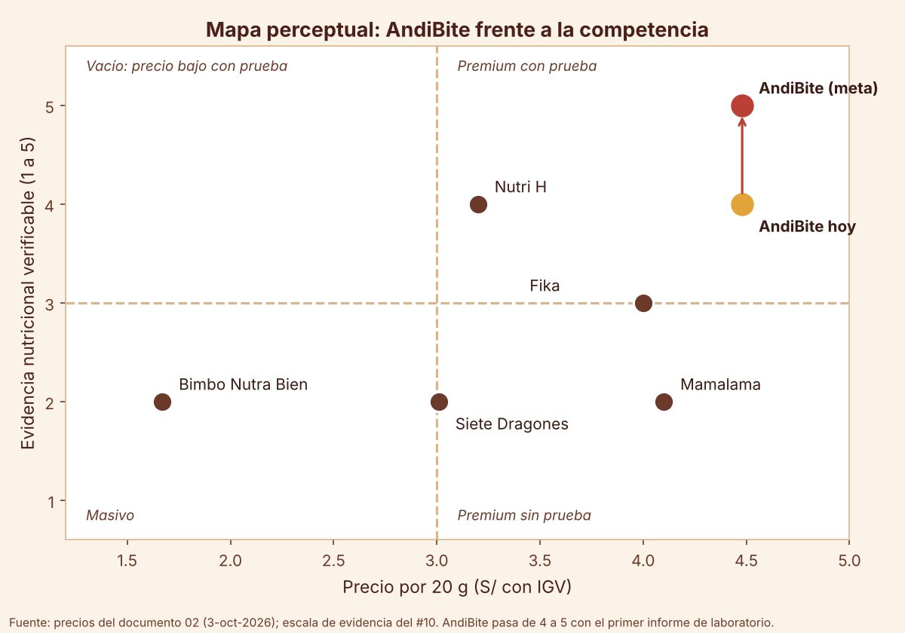

# T2 · #10 Posicionamiento
Responsable: Patricia Cárdenas · Grupo 2 · AndiBite · Propuesta para revisar

**Siglas.** NSE: nivel socioeconómico (A es el más alto). IGV: impuesto general a las ventas (los precios al público lo incluyen). ODS: Objetivos de Desarrollo Sostenible. QR: código que se lee con la cámara del celular. IA: inteligencia artificial. RM: resolución ministerial. Kantar: empresa de estudios de mercado.

## Para qué sirve este punto

La clase pregunta: "¿Cómo quieres que te recuerden?" El posicionamiento es el lugar que AndiBite quiere ocupar en la cabeza del padre frente a la competencia. Usamos el prompt 3 de la sesión 09, completado con los datos de AndiBite, y comparamos con 4 competidores con precios reales y fechados: Nutri H, Fika, Mamalama y Bimbo Nutra Bien.

## 1. Prompt 3 completado (IA)

"Eres un estratega de marketing y posicionamiento de marca. Tu tarea es ayudar a un emprendedor a establecer una estrategia clara de posicionamiento para su producto o servicio, basada en insights del cliente, análisis competitivo y diferenciadores de valor. El contexto es un proyecto de negocio en desarrollo, orientado a un ODS, construido bajo el modelo Business Model Canvas.

- **Nombre del producto:** AndiBite, mini brownie de lonchera de 20 g con sangrecita de res en polvo (hierro hemo), sabores Chispa, Andi y Lúcu.
- **ODS vinculado:** ODS 2 Hambre cero, meta 2.2 (poner fin a todas las formas de malnutrición). Complementarios: ODS 3 Salud y bienestar y ODS 8 Trabajo decente.
- **Propuesta de valor:** el snack de lonchera con hierro que el niño sí se come, con el hierro medido en cada lote y visible en la app.
- **Segmento de cliente objetivo:** padres y madres de 32 a 45 años, NSE (nivel socioeconómico) A y B de Lima Top y Lima Moderna, con hijos de 4 a 11 en colegio privado. Planificados, leen etiquetas, invierten en educación y salud. El A busca pruebas; el B busca resolver la semana.
- **Insight relevante del cliente:** 'Todo lo que le hace bien, mi hijo lo escupe.' (Claudia, segmento A) y 'No me vendas salud, véndeme una mañana menos.' (Rodrigo, segmento B).
- **Principales competidores:** Nutri H (galleta con hemoglobina bovina), Fika (brownie bajo en azúcar con harina de quinua), Mamalama (barra energética de chocolate bitter y maca) y Bimbo Nutra Bien (mini brownie masivo).
- **Diferenciador clave:** es el único que mide el hierro de cada lote en laboratorio y lo publica en una app que se abre con el QR del envase, en un formato que el niño ya quiere (brownie) y que se prueba gratis antes de comprar.

A partir de esta información, realiza lo siguiente: 1. Estrategia de posicionamiento: frase de posicionamiento con el formato 'Para [segmento], que busca [necesidad], [marca] ofrece [beneficio clave], porque [razón para creer o prueba]'; territorio de marca; resumen de atributos competitivos clave. 2. Mapa perceptual: 2 ejes con atributos relevantes para el consumidor, ubica tu producto y al menos 3 competidores e interpreta la posición."

## 2. Diferenciación: qué nos hace únicos

1. **Medido, no prometido.** Cada lote se analiza en laboratorio (cada lote de enero a junio y cada 2 meses desde julio) y el resultado se publica en la app. Ningún competidor revisado publica su análisis por lote.
2. **Formato que el niño ya quiere.** Un mini brownie de cacao esconde la sangrecita. Nutri H es una galleta; Fika y Bimbo son brownies pero sin hierro funcional.
3. **Se prueba antes de comprar.** La venta es cara a cara: el niño prueba en el stand y el padre compra ahí mismo.
4. **La app "Andi, Misión Hierro".** Plan de loncheras, semáforo de hierro semanal, recordatorio del control de hemoglobina y recompra en 1 clic por WhatsApp. El modo niños educa sin vender (Ley 30021).
5. **Tono adulto y legal.** Hablamos de hierro, no de enfermedad. Nunca decimos "previene la anemia".

## 3. Frase de posicionamiento

**Frase general:** Para padres y madres A y B de Lima Top y Lima Moderna con hijos de 4 a 11 años en colegio privado, que buscan que su hijo coma hierro sin pelear, AndiBite ofrece un mini brownie de lonchera que el niño sí se come, porque cada lote se analiza en laboratorio y el padre ve el resultado en la app con el QR del envase.

**Versión para el segmento A (Claudia):** Para la madre o el padre que lee etiquetas y le pregunta al pediatra, que busca una prueba y no una promesa, AndiBite ofrece hierro medido en un brownie que su hijo no escupe, porque el informe del laboratorio de su lote está a un escaneo de distancia.

**Versión para el segmento B (Rodrigo):** Para el padre o la madre que trabaja y organiza la semana, que busca una lonchera resuelta sin pensar, AndiBite ofrece el pack de 12 "Semana completa" a S/4.16 por brownie, porque aguanta la mochila sin frío, trae 3 sabores y la app avisa por WhatsApp antes de que se acabe.

Las tres versiones calzan con la del documento 10 (sección 3.2): mismo segmento, mismo beneficio y la misma razón para creer.

## 4. Territorio de marca

**"Medido, no prometido."** (territorio de marca decidido en este punto; el slogan, decidido en el #11, es "Hierro medido. Sabor a brownie.") Es la tranquilidad de lo comprobado en la lonchera.

- **Idea simbólica:** el dato que se puede ver. El lote, el laboratorio y el QR son el símbolo de la marca, igual que el cacao lo es del sabor.
- **Idea emocional:** el alivio de que el hijo coma bien sin pelear. Para A es tranquilidad ("ya sé lo que come"); para B es tiempo ("una mañana menos").
- **Idea aspiracional:** ser el padre que no adivina, que decide con datos y que igual deja que su hijo disfrute.
- **Qué no es el territorio:** no es miedo a la anemia, no es "superalimento", no es "orgullo peruano" genérico. El origen andino (cañihua, lúcuma, cacao) suma como historia, pero no es el centro.
- **Personalidad:** una nutricionista amiga que además es mamá: precisa, tranquila, con humor seco (documento 06).

## 5. Matriz de atributos frente a los competidores

Precios con IGV tomados el 3-oct-2026 (documento 02), salvo donde se indica.

| Atributo | AndiBite | Nutri H | Fika | Mamalama | Bimbo Nutra Bien |
|---|---|---|---|---|---|
| **Producto** | Mini brownie de 20 g con sangrecita de res en polvo | Galleta clásica con hemoglobina bovina, 30 unidades de unos 10 g | Brownie bajo en azúcar con harina de quinua, 70 g | Barra energética de chocolate bitter y maca, 5 de 20 g | Mini brownie, 6 de 30 g |
| **Precio por 20 g** | S/4.16 (pack de 12 por WhatsApp), S/4.48 (pack de 6 por WhatsApp), S/4.65 (pack de 6 en el stand) | S/3.20 (caja de 30 a S/48.00) | S/4.00 (S/14.00 los 70 g) | S/4.10 (caja de 5 a S/20.50) | S/1.67 (paquete de 6 a S/15.00) |
| **Ingrediente funcional** | Hierro hemo de la sangrecita, cañihua en el sabor Andi | Hierro hemo de la hemoglobina bovina | Quinua; sin azúcar, endulzado con alulosa, y sin gluten (store check) | Maca | Harina de trigo fortificada con hierro (obligatoria en Perú por la Ley 28314) |
| **Hierro declarado** | Se publica el dato del laboratorio por lote; el cálculo da unos 1.9 mg por brownie [POR CONFIRMAR en laboratorio] | 16.5 mg en su tabla, sin aclarar si es por galleta, porción o caja (nutrih.pe, 19-oct-2026) | No es su promesa | No es su promesa | No es su promesa |
| **Medición publicada por lote** | Sí, en la app con el QR | No | No | No | No |
| **Octógonos** | Meta: ninguno (lo confirma el laboratorio) [POR CONFIRMAR] | No aparecen en su web [POR CONFIRMAR en el empaque] | Sin octógonos (documentos 07 y 10) | [POR CONFIRMAR en góndola] | Su web declara 10 g de azúcar por porción; si la porción es una unidad de 30 g, le corresponde el octógono "Alto en azúcar" [POR CONFIRMAR en góndola] |
| **Pensado para la lonchera infantil** | Sí: porción de 20 g sellada, sin frío, 3 sabores para la semana | Sí, con mensaje contra la anemia | No, es para adultos que cuidan el azúcar | No, es una barra energética para adultos | Sí, snack masivo |
| **Canal** | Stands en malls, ferias, eventos, quioscos de colegio, naturistas; recompra por WhatsApp | Web propia con envío nacional (Ayacucho) y puntos de venta de Lima | Web propia, delivery en Lima en 24 h | Wong y Plaza Vea | Plaza Vea y supermercados |
| **Tecnología** | App con hierro del lote, plan de loncheras y recompra | Tienda web | Tienda web | No | No |
| **Cómo habla** | Hierro medido; nunca "previene la anemia" | "Antianémico", "superalimento", "contribuye en la lucha contra la anemia" (nutrih.pe, 19-oct-2026) | Bajo en azúcar, sin gluten | Energía | Marca masiva y familiar |

**Lectura de la matriz:**
- Nutri H es el competidor más cercano: también usa hierro hemo y le habla a la anemia infantil. Pero es una galleta, cuesta menos (S/3.20 por 20 g) y usa palabras como "antianémico" que AndiBite evita por riesgo legal.
- Fika es el premium "limpio": AndiBite cuesta S/0.16 a 0.65 más por 20 g. Esa diferencia se justifica con el hierro medido y la app: "por unos céntimos más, el hierro medido y la app" (documento 10).
- Bimbo Nutra Bien es el ancla de precio masivo: cuesta menos de la mitad, pero no ofrece hierro funcional ni la meta sin octógono.

## 6. Mapa perceptual

**Eje X: precio por 20 g, en soles con IGV** (dato real, documento 02, 3-oct-2026). La línea que divide el mapa está en S/3.00, el límite entre los masivos (S/1.10 a 1.70) y los premium o funcionales (S/3.00 a 4.10).

**Eje Y: confianza o evidencia nutricional, escala del 1 al 5.** Puntuamos lo que el padre puede verificar en el empaque o en la web, no lo que la marca promete:

| Puntaje | Qué significa |
|---|---|
| 1 | Sin ninguna declaración nutricional destacada; se vende solo por sabor o precio |
| 2 | Declaración general ("energética", "nutritivo", harina fortificada) sin una cifra que el padre pueda usar |
| 3 | Perfil "limpio" y claro (bajo en azúcar, sin gluten, sin octógonos), pero sin un nutriente funcional medido |
| 4 | Nutriente funcional declarado con cifra en la tabla (por ejemplo, hierro), sin análisis por lote publicado |
| 5 | Nutriente funcional medido por lote en laboratorio y publicado para el consumidor |

La línea que divide el mapa está en 3.

| Marca | X: precio por 20 g | Y: evidencia (1 a 5) | Por qué ese puntaje | Cuadrante |
|---|---|---|---|---|
| **AndiBite** | S/4.16 a 4.65 (punto medio S/4.48) | 5 (meta) | Hierro medido por lote y publicado en la app. Hoy, sin el primer informe, estaría en 4 [POR CONFIRMAR] | Precio alto, evidencia alta |
| Nutri H | S/3.20 | 4 | Declara 16.5 mg de hierro, pero sin aclarar la porción y sin análisis por lote publicado | Precio alto, evidencia alta (en el borde de precio) |
| Fika | S/4.00 | 3 | Bajo en azúcar, sin gluten y sin octógonos; no promete un nutriente funcional | Precio alto, evidencia media |
| Mamalama | S/4.10 | 2 | "Energética" y maca, sin cifra que el padre pueda usar | Precio alto, evidencia baja |
| Siete Dragones (referencia) | S/3.01 | 2 | Cañihua y nibs de cacao, sin cifra funcional destacada [POR CONFIRMAR] | Borde de precio, evidencia baja |
| Bimbo Nutra Bien | S/1.67 | 2 | Harina fortificada en los ingredientes, sin promesa funcional; 10 g de azúcar por porción | Precio bajo, evidencia baja |

**Los cuatro cuadrantes:**
- **Precio alto y evidencia alta ("premium con prueba"):** AndiBite, y Nutri H en el borde. Es el espacio que queremos ocupar.
- **Precio alto y evidencia baja ("premium sin prueba"):** Fika, Mamalama y Siete Dragones. Cobran como premium por sabor, ingredientes o estilo de vida, pero el padre no puede verificar un beneficio funcional.
- **Precio bajo y evidencia baja ("masivo"):** Bimbo Nutra Bien. Gana por precio y por estar en todas las góndolas.
- **Precio bajo y evidencia alta:** vacío. No es nuestro espacio: con un costo de S/1.64 por brownie y el gasto de los stands, no podemos competir ahí.

## 7. Interpretación: dónde está la oportunidad

- **AndiBite queda casi solo en el cuadrante "premium con prueba".** Es el lugar que pide el 42 % que desconfía de lo envasado (Kantar 2025) y el padre que pregunta "¿cuántos mg de hierro tiene?".
- **El riesgo es el precio.** AndiBite es el más caro por 20 g del grupo. Si no publica el informe del laboratorio, cae al puntaje 4, al lado de Nutri H, pero más caro. **El informe del laboratorio es la base del posicionamiento**, no un detalle técnico.
- **Frente a Nutri H** ganamos por formato (brownie que el niño pide), por la medición publicada y por el tono legal. Frente a Fika ganamos por el hierro y la app, a un precio parecido.
- **Para el segmento B**, el mapa se lee por precio: por eso se le muestra primero el pack de 12 a S/4.16, el más cercano a Fika (S/4.00) y a Mamalama (S/4.10).
- **Lo que el padre debe recordar:** "es el brownie con el hierro medido". Esa es la idea que repiten el slogan, el empaque y el stand.

## 8. Qué corregimos o validamos en el resultado de la IA

- **Validado:** todos los precios por 20 g son reales y fechados (documento 02, 3-oct-2026), y los textos de Nutri H y Bimbo se revisaron en sus páginas el 19-oct-2026.
- **Corregido:** una IA suele poner "sin octógonos" o "alto en hierro" como hechos. Aquí son metas hasta tener el informe del laboratorio. También ubica a la marca propia en 5 sin explicar; nosotros lo marcamos como meta y decimos que hoy estaría en 4.
- **Lo que falta:** confirmar en góndola los octógonos de Mamalama, Bimbo Nutra Bien y Nutri H en el store check [POR CONFIRMAR]. La página de Plaza Vea de Bimbo Nutra Bien mostraba el 19-oct-2026 precios que no cuadran entre sí y el producto agotado; usamos el precio del 3-oct-2026.

## Fuentes

- 04-reformulacion/02-insumos-proveedores-y-costeo.md, sección 4 (precios de la competencia del 3-oct-2026).
- 03-entregables/07-store-check-la-molina.md, sección 2 (lista de competidores y atributos).
- 04-reformulacion/10-plan-de-marketing-2027.md, secciones 3.2 a 3.4, y 04-reformulacion/06-marca-2-0-e-innovacion.md, secciones 1 y 6 (donde dice Hemi, léase AndiBite).
- 04-reformulacion/T2/HECHOS_v7.md (19-oct-2026).
- Prompt 3 de la clase: 04-reformulacion/T2/CLASE-sesion09.md y PPT Sesión 09 de la docente.
- Nutri H. Nutri H clásica x 30 (consulta del 19-oct-2026). https://nutrih.pe/producto/nutri-h-clasica-x-30/
- Fika. Brownie (consulta del 3-oct-2026). https://www.fika.pe/products/brownie-55g
- Wong. Barra energética chocolate bitter y maca Mamalama, caja de 5 (consulta del 3-oct-2026). https://www.wong.pe/barra-energetica-chocolate-bitter-y-maca-mamalama-caja-5-unid/p
- Plaza Vea. Mini brownie Nutra Bien Bimbo 180 g, paquete de 6 (consultas del 3-oct-2026 y del 19-oct-2026). https://www.plazavea.com.pe/mini-brownie-nutra-bien-bimbo-180g-paquete-6un/p
- Plaza Vea. Barra nibs de cacao y cañihua Siete Dragones, caja de 5 (consulta del 3-oct-2026). https://www.plazavea.com.pe/barra-nibs-de-cacao-y-canihua-siete-dragones-caja-5un/p
- Kantar. Consumo saludable en Perú (15-may-2025). https://www.kantar.com/latin-america/inspiracion/consumidor/2025/consumo-saludable-peru-tendencia
- Congreso de la República. Ley 28314, que dispone la fortificación de la harina de trigo. https://www.leyes.congreso.gob.pe/Documentos/Leyes/28314.pdf
- Congreso de la República. Ley 30021, de promoción de la alimentación saludable. https://www.leyes.congreso.gob.pe/Documentos/Leyes/30021.pdf
