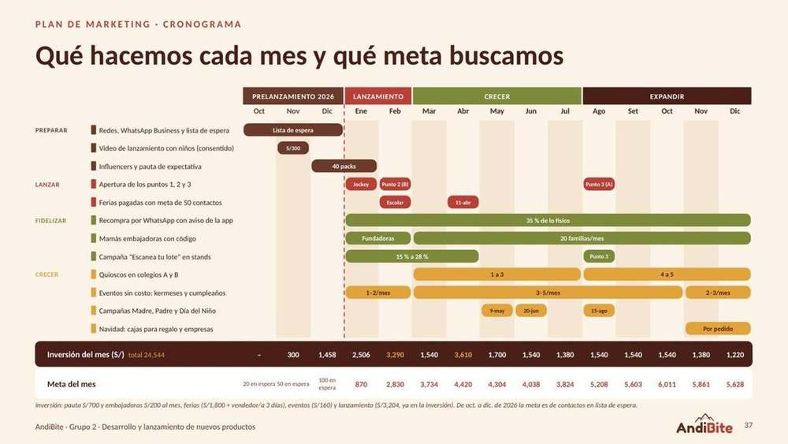

# T2 · #18 Diagrama de Gantt del plan de marketing
Responsable: Angie Blas · Grupo 2 · AndiBite · Propuesta para revisar

**Qué es.** Un diagrama de Gantt muestra qué actividad ocurre en qué mes. Aquí van las 12 actividades del plan de marketing (documento 10 y `plan_mkt.json`, campo `gantt`), de **octubre de 2026 a diciembre de 2027** (15 meses), con el responsable de cada una, la inversión de cada mes y los hitos. Un ■ marca un mes en que la actividad está activa.

**El Gantt visual (con colores y metas por mes) está en la diapositiva 37 de la TC5-8 ("Plan de marketing · Cronograma") y irá en la presentación final.** Esta tabla es la versión en texto para el documento escrito.

**Siglas.** Pauta: publicidad pagada en Meta (Instagram y Facebook) y YouTube. QR: código del envase que abre la app. A y B: segmentos del público (Claudia, A; Rodrigo, B). TC5-8: trabajos de campo 5 a 8 del curso. MINEDU: Ministerio de Educación. POP: material de punto de venta. IGV: impuesto general a las ventas. Los hitos H1 a H8 se explican en la sección 2.

---

## 1. Tabla de Gantt

| # | Grupo | Actividad | Responsable | Oct-26 | Nov | Dic | Ene-27 | Feb | Mar | Abr | May | Jun | Jul | Ago | Set | Oct | Nov | Dic |
|---|---|---|---|---|---|---|---|---|---|---|---|---|---|---|---|---|---|---|
| 1 | Preparar | Redes y WhatsApp: las primeras 100 familias | Angie (perfiles y contenido); Carlos (WhatsApp Business y lista de familias, hasta que entre la coordinadora) | ■ | ■ | ■ |  |  |  |  |  |  |  |  |  |  |  |  |
| 2 | Preparar | Video "Lo que nadie ve" (video maestro; hablan adultos, el niño no sale) | Angie (producción); Adela (permiso firmado de los adultos que salen) |  | ■ |  |  |  |  |  |  |  |  |  |  |  |  |  |
| 3 | Preparar | Influencers y concurso #LoQueNadieVe | Angie (selección y pauta); Patricia (despacho); Adela (#publicidad, bases del concurso) |  | ■ | ■ | ■ |  |  |  |  |  |  |  |  |  |  |  |
| 4 | Lanzar | Stands con el mural (apertura de los puntos 1, 2 y 3) | Carlos; vendedores pagados |  |  |  | ■ | ■ |  |  |  |  |  | ■ |  |  |  |  |
| 5 | Lanzar | Ferias pagadas con meta de 50 contactos | Carlos (contrato); Angie (material) |  |  |  |  | ■ |  | ■ |  |  |  |  |  |  |  |  |
| 6 | Fidelizar | Recompra por WhatsApp con aviso de la app | Coordinadora; Angie (app) |  |  |  | ■ | ■ | ■ | ■ | ■ | ■ | ■ | ■ | ■ | ■ | ■ | ■ |
| 7 | Fidelizar | Papás y mamás embajadores con código | Carlos; coordinadora |  |  |  | ■ | ■ | ■ | ■ | ■ | ■ | ■ | ■ | ■ | ■ | ■ | ■ |
| 8 | Fidelizar | Campaña "Escanea tu lote" en stands | Coordinadora y vendedores; Angie (mide en /admin) |  |  |  | ■ | ■ | ■ | ■ |  |  |  | ■ |  |  |  |  |
| 9 | Crecer | Quioscos en colegios A y B | Carlos; Diana (ficha y análisis del lote) |  |  |  |  |  | ■ | ■ | ■ | ■ | ■ | ■ | ■ | ■ | ■ | ■ |
| 10 | Crecer | Eventos sin costo: kermeses y cumpleaños | Carlos; vendedores pagados |  |  |  | ■ | ■ | ■ | ■ | ■ | ■ | ■ | ■ | ■ | ■ | ■ | ■ |
| 11 | Crecer | Campañas Madre, Padre y Día del Niño | Angie; Carlos; coordinadora |  |  |  |  |  |  |  | ■ | ■ |  | ■ |  |  |  |  |
| 12 | Crecer | Navidad: cajas para regalo y empresas | Carlos; coordinadora |  |  |  |  |  |  |  |  |  |  |  |  |  | ■ | ■ |
| | | **Inversión del mes (S/)** | Adela lleva el gasto | 0 | 300 | 1,458 | 2,506 | 3,290 | 1,540 | 3,610 | 1,700 | 1,540 | 1,380 | 1,540 | 1,540 | 1,540 | 1,380 | 1,220 |
| | | **Hitos** | |  |  |  | H1 | H2, H4 |  | H5 | H6 | H7 |  | H3, H8 |  |  |  |  |

Cómo leerla: 2026 son las tres primeras columnas (Oct-26, Nov, Dic); Ene-27 a Dic son los 12 meses del año 1. Las últimas tres columnas con nombre repetido (Oct, Nov, Dic) son de 2027. Comprobación de la fila de inversión: 0 + 300 + 1,458 + 2,506 + 3,290 + 1,540 + 3,610 + 1,700 + 1,540 + 1,380 + 1,540 + 1,540 + 1,540 + 1,380 + 1,220 = **S/24,544**, igual al presupuesto (documento #17).

### Detalle de las actividades con varias etapas

| # | Actividad | Etapas (según la diapositiva de la TC5-8) |
|---|---|---|
| 1 | Redes y WhatsApp: las primeras 100 familias | Oct–dic 2026: familias que nos escriben por WhatsApp para enterarse primero. Meta: 100 familias (antes del 2-ene-2027) y 500 seguidores a diciembre |
| 2 | Video "Lo que nadie ve" | Nov 2026: S/300 (en el presupuesto figura como "Video con niños"; léase "Video de lanzamiento"). Hablan adultos y el niño no sale en cámara; permiso firmado de los adultos. Listo el 30-nov |
| 3 | Influencers y concurso #LoQueNadieVe | 1-nov a 20-dic 2026: concurso (S/600 de expectativa: S/360 de pauta y S/240 en premios; 3 ganadores, un mes de lonchera cada uno; se presentan el 2-ene). Dic 2026 a ene 2027: 40 packs (20 A y 20 B), S/458 |
| 4 | Stands con el mural | Ene: Jockey Plaza (2 y 3 de enero). Feb: Salaverry (B). Ago: La Molina (A) |
| 5 | Ferias pagadas | Feb: campaña escolar. Abr: Día del Niño Peruano, 11 de abril. Meta: 50 contactos de WhatsApp cada una |
| 6 | Recompra por WhatsApp | Ene–dic 2027: 35 % de lo vendido en físico |
| 7 | Papás y mamás embajadores | Ene–feb: fundadores (10 en enero). Mar–dic: 20 familias nuevas al mes |
| 8 | "Escanea tu lote" | Ene–abr: de 15 % a 28 % de envases escaneados. Ago: otra vez al abrir el punto 3 |
| 9 | Quioscos en colegios | Mar–jul: de 1 a 3 colegios. Ago–dic: 4 a 5 colegios (2 A y 3 B) |
| 10 | Eventos sin costo | Ene–feb: 1 a 2 al mes. Mar–oct: 3 a 5 al mes. Nov–dic: 2 a 3 al mes (40 en el año) |
| 11 | Campañas de fechas | May: Día de la Madre. Jun: Día del Padre. Ago: Día del Niño de agosto |
| 12 | Navidad | Nov–dic: cajas para regalo y empresas, por pedido |

## 2. Hitos

| Código | Hito | Fecha | Mes en el Gantt | Responsable |
|---|---|---|---|---|
| H1 | **Apertura del punto 1:** Jockey Plaza (A y B) | Primer fin de semana de enero de 2027 (2 y 3 de enero) [POR CONFIRMAR con el mall] | Ene-27 | Carlos |
| H2 | **Apertura del punto 2:** Salaverry (B) | Febrero de 2027 [POR CONFIRMAR el local] | Feb | Carlos |
| H3 | **Apertura del punto 3:** La Molina (A) | Agosto de 2027 [POR CONFIRMAR el local] | Ago | Carlos |
| H4 | **Feria pagada de campaña escolar** | Febrero de 2027 [POR CONFIRMAR organizador y fecha] | Feb | Carlos; Angie (material) |
| H5 | **Feria pagada del Día del Niño Peruano** | Domingo 11 de abril de 2027 [POR CONFIRMAR organizador] | Abr | Carlos; Angie (material) |
| H6 | **Día de la Madre** | Domingo 9 de mayo de 2027 | May | Angie; Carlos |
| H7 | **Día del Padre** | Domingo 20 de junio de 2027 | Jun | Angie; coordinadora |
| H8 | **Día del Niño de agosto** (fecha comercial de los malls, no es feriado) | Domingo 15 de agosto de 2027 | Ago | Angie; Carlos |

Otros hitos del plan (documento 10):

- 31-oct-2026: perfiles de Instagram, Facebook y WhatsApp Business listos (Angie).
- 1-nov-2026: arranca el concurso #LoQueNadieVe (hasta el 20-dic; votos hasta el 31-dic). Adela confirma con la ONAGI antes de esa fecha.
- 30-nov-2026: video maestro "Lo que nadie ve" listo (Angie).
- 2-ene-2027: los 3 ganadores abren el mural de Jockey Plaza; se graba el testimonial.
- Dic-2026: vendedores capacitados al 100 % antes de abrir (Carlos y coordinadora).
- Mar-2027: primer quiosco (A); 3 colegios en mayo; 5 en octubre.
- Jun-2027: revisión de mitad de año (los 5 socios).
- 16-oct-2027: "Los trucos del año" [PROPUESTA] (Angie); los informes de hierro de los lotes siguen en la app (Diana).
- Dic-2027: informe de las reglas para crecer en 2028 (Carlos y los 5 socios).

## 3. Inversión por fase

| Fase | Meses | Inversión (S/) | Meta clave |
|---|---|---|---|
| Prelanzamiento | Oct–dic 2026 | 1,758 | 100 familias en WhatsApp |
| Lanzamiento | Ene–feb 2027 | 5,796 | 3,700 brownies |
| Crecer | Mar–jul 2027 | 9,770 | 20,320 brownies; 3 colegios |
| Expandir | Ago–dic 2027 | 7,220 | 28,311 brownies; unas 2,300 familias en WhatsApp |
| **Total** | **15 meses** | **24,544** | |

**De dónde sale el total (igual que en el tema #17).** El presupuesto mensual de marketing se mantiene en S/900: S/700 de pauta, degustación y material más S/200 de embajadores (S/10,800 en 2027). A eso se suman el lanzamiento (S/3,204), las 2 ferias pagadas (S/4,140) y los 40 eventos sin costo (S/6,400): 10,800 + 3,204 + 4,140 + 6,400 = S/24,544.

## 4. Pendientes del cronograma

- Fechas de las 2 ferias, de la apertura de Jockey y de los puntos 2 y 3: [POR CONFIRMAR] con los organizadores y los malls.
- Calendario escolar 2027 del MINEDU (inicio de clases, vacaciones de medio año): [POR CONFIRMAR]; se usa el de 2026 como referencia.
- Feriados de 2027: lista de un tercero; se cruza con gob.pe [POR CONFIRMAR].

---

## Fuentes

- `04-reformulacion/10-plan-de-marketing-2027.md`, secciones 5, 6 y 7 (fases, presupuesto, mes a mes y calendario).
- `04-reformulacion/TC5-8/fuente/plan_mkt.json` (campo `gantt` y `presupuesto_mensual`) y diapositiva 37 de `04-reformulacion/TC5-8/TC5-8-AndiBite.pptx`.
- `04-reformulacion/Presupuesto-marketing-AndiBite.xlsx` (inversión por mes).
- HECHOS_v7 (decisiones del 19-oct, 20-oct y 27-oct-2026) y `T2/web-presentacion/CAMPANA-lo-que-nadie-ve.md` (nombres de las filas del Gantt).
- Fechas: Ley 27666 (Día del Niño Peruano, segundo domingo de abril); Hacecuentas, "Feriados Perú 2027" (lista de un tercero). https://hacecuentas.com/feriados-peru-2027
- MINEDU, calendario escolar 2026 (referencia). https://elbuho.pe/2026/02/ano-escolar-2026-minedu-establecio-el-calendario-escolar-y-fijo-el-dia-de-inicio-de-clases/
